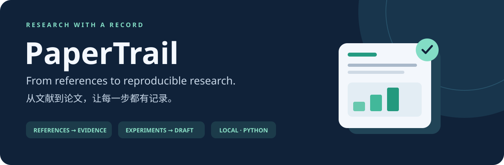
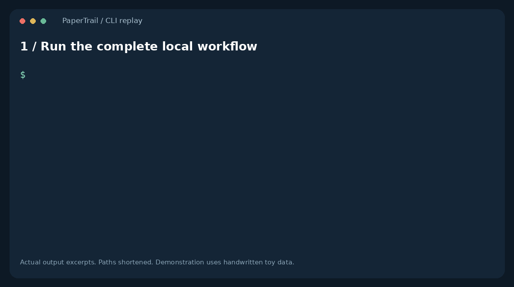
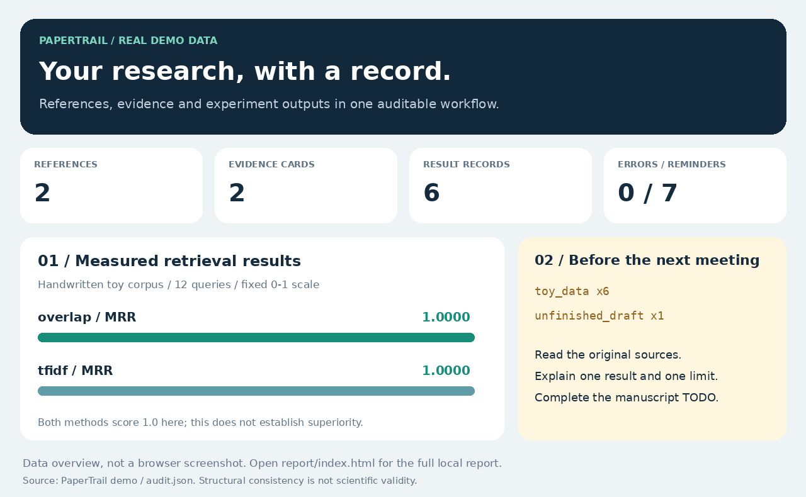

<div align="center">



# PaperTrail · 从文献到论文的科研工作流

**论文还没写，文献、实验和笔记已经散了？先把科研过程接起来。**

给大学生的本地科研起步工具：文献 → 证据卡 → 实验 → 草稿 → 组会记录。

[](https://github.com/lashonbakker-crypto/papertrail-research/actions/workflows/ci.yml)


[](LICENSE)

[**5 分钟跑通**](#5-分钟跑通) · [新手 7 天路线](docs/01-first-week.md) · [论文工作流](docs/02-workflow.md) · [English](README.en.md) · [下载单文件版](https://github.com/lashonbakker-crypto/papertrail-research/releases/latest)

</div>

你可能正在准备大创、第一次进课题组、毕业论文，或想把真实科研经历整理进保研材料。这里解决一个具体问题：**写下的论点能找到来源，登记的结果能找到原始记录，交给导师的内容能说清楚自己做了什么。**

## 先看你能拿到什么

| 常见卡点 | PaperTrail 的实际功能 |
|---|---|
| 看了很多文献，写时记不起哪篇支持哪句话 | 用 `evidence.csv` 记录论点、引用键、章节定位和自己的阅读笔记 |
| AI 或手工写了一个不存在的引用键 | `check` 检查正文中的 `[@key]` 是否存在，指出缺失来源 |
| 实验结果复制错了、原始文件变了 | 导入自己的结果 CSV，保存原始快照，核对数值、附件和可选输入指纹 |
| 文献在 Zotero，草稿在另一个工具 | 导入标准 CSL-JSON；生成适合后续 Pandoc/编辑器处理的 Markdown 草稿 |
| 已有自己的实验，怎么连接到草稿 | `import-results` 登记实际指标；`{{run:ID}}` 在报告草稿中展开 |
| 不知道第一次实验从哪开始 | 一条命令运行 8 个文档 / 12 个查询的英文检索教学实验 |
| 组会和申请材料只剩一个 PDF | 导出可视化 HTML 检查报告、JSON 结果和 Markdown 科研交接记录 |



## 5 分钟跑通

需要 Python 3.10 或以上。源码方式不安装第三方包，不需要 API key；演示可以离线运行。

如果使用完整离线交付包，先看[解压运行与十分钟练习](docs/00-offline-start.md)。也可以直接克隆源码：

```bash
git clone https://github.com/lashonbakker-crypto/papertrail-research.git
cd papertrail-research
python -m papertrail demo my-first-study
```

打开 `my-first-study/report/index.html`。你会看到 **2 篇已核对元数据的真实背景文献、2 张证据卡、6 条结果记录**，以及仍需处理的教学数据提醒和草稿 TODO。

```text
STRUCTURE CHECK OK: 0 error(s), 7 reminder(s)
```

报告的提醒是演示的一部分：原文阅读、实验设计和结论范围仍然需要你判断。

**最小练习**：在生成的 `manuscript.md` 末尾添加 `参考 [@notExists2026]`，再运行：

```bash
python -m papertrail check my-first-study
```

你应看到 `missing_reference`，退出码为 `2`。删除这行后恢复为 `0`。这就是把一个写作疏漏变成可检查的流程。

## 真实演示的报告数据预览



上图用真实 `demo` 输出生成，展示报告中的统计和提醒；它是数据概览。完整 HTML 报告在你的本地项目中打开。

每次导出生成四个文件：

| 文件 | 用途 |
|---|---|
| `index.html` | 本地打开的可视化报告；不请求外部字体、脚本或分析服务 |
| `audit.json` | 机器可读的错误、提醒、文献、证据和结果记录 |
| `draft.md` | 展开 `{{claim:C1}}`、`{{run:demo-overlap-mrr}}` 等标记的 Markdown 草稿 |
| `handoff.md` | 给下一次组会准备的证据与实验交接记录 |

现有输出目录不会被覆盖。重新生成时使用新目录，例如：

```bash
python -m papertrail report my-first-study --out my-first-study/report-v2
```

## 接上你自己的实验

```bash
python scripts/course_example.py course-study
```

这会**实际运行**一个自编课程分类实验：仅用训练行选择模型，计算四条测试记录的 accuracy（多数类 `0.25`、阈值分类器 `0.75`），保留数据、程序和逐条预测，导入后生成报告。它是教学流程示例，不能当成真实科研结论；完整步骤和失败练习见[自己的实验](docs/05-own-experiments.md)。

已有指标 CSV 时，使用固定列 `method,metric,value,n`：

```bash
python -m papertrail import-results my-research results.csv --run-id trial1 --dataset "具体数据版本与切分" --label toy --command "python my_experiment.py"
```

先创建 `my-research` 并准备你实际计算的 `results.csv`。可重复 `--input data/FILE` 登记项目内数据/代码的指纹。`toy/real` 是显式自报，命令只记录不执行；检查结果一致不等于独立复现。源码包含完整课程练习，单文件版也支持指标导入。

## 开始自己的课题

```bash
python -m papertrail init my-research
python -m papertrail import-csl my-research zotero-export.json
python -m papertrail check my-research
```

想先用公开元数据练习，可直接运行[自带的 CSL-JSON 示例](docs/06-zotero-import.md)，再换成自己的导出文件。

在 Zotero 中选择需要的条目，右键导出，格式选择 **CSL JSON**。这是元数据导入，阅读笔记由你自己填写。引用键优先取已提供的 `citation-key`，否则取 `id`；选中的值不合法时生成 `ref1` 等键；重复键或 DOI 会拒绝整个导入，不静默覆盖。

还可以明确选择联网，从 Crossref 获取单条 DOI 的标题、作者和年份：

```bash
python -m papertrail add-doi my-research 10.1038/nature14539 --key lecun2015
```

该命令只保存元数据，不下载论文、不读取账户、也不生成论文。Crossref 未查到不等于论文不存在，部分 DOI 由 DataCite 等其他机构注册。详见[命令说明与网络边界](docs/03-cli.md)。

## AI 怎么帮忙

附带[可直接复制的提示词](prompts/README.md)：把你已经阅读的原文片段、证据卡和实验记录交给 ChatGPT 等工具，用于拆解问题、检查论证、修改表达和准备组会。

流程是 **你提供证据 → AI 辅助整理 → 你核对 → 本地检查记录一致性**。这一版不内置 LLM/API 调用。只有 `add-doi` 会显式访问 Crossref。

## 学会它，能怎样用于科研经历

[贡献记录模板](templates/contribution-log.md)帮你记录自己负责的具体工作、提交、数据版本、结果和局限；[组会模板](templates/advisor-update.md)帮你解释进展；[材料整理清单](docs/04-research-portfolio.md)帮你把真实成果组织起来。

写论文、保研材料或实习简历时，先重跑自己的实验，再解释一张证据卡和一个失败案例。科研经历的价值来自你实际完成和理解的工作。

## 检查范围与目前限制

- 检查引用键、证据定位登记、结构化结果、文件内容指纹和已知实验数值；导入 CSV 会从保存的原始快照复核记录，外部命令仍需独立复现。未知附件结构只核对指纹并提醒。`reviewed=yes` 是人工登记，不是机器判定论文正确。
- 普通文本中的任意数字、文献是否真正支持结论、创新性、因果性、撤稿状态和期刊排版需要人工或专门工具处理。
- 内置实验是很容易的自编英文词法检索小样本：两种方法的 MRR / Recall@1 / Recall@3 均为 `1.0`。没有独立测试集，没有运行 RAG、BEIR 或语言模型，不能据此判断方法优越性。
- 不执行表里的命令，不追踪符号链接；项目文件单个上限 8 MiB。没有并发写入锁或文件系统快照，操作期间请不要同时修改输入。
- CSV/JSON/Markdown 是本版本输入；PDF 抽取、Word/LaTeX 投稿格式、自动文献综述和多人同步列在路线图中。

## 验证与参与

```bash
python -m unittest discover -s tests -v
python scripts/course_example.py
python scripts/build_zipapp.py
python dist/papertrail.pyz demo portable-study
```

[验证记录](docs/validation.md)区分本地检查、远程 CI 和在线接口检查。[贡献指南](CONTRIBUTING.md)列出真实可参与任务，[路线图](ROADMAP.md)区分已实现和计划中的功能。

**觉得它能帮你少走弯路，就点个 Star 存下；先跑完一次 demo，再带着具体问题来提 Issue。** 也欢迎把自己的公开复现案例贡献回来。

## 来源与许可

示例背景文献来自 [RAG 原论文](https://arxiv.org/abs/2005.11401)和 [BEIR 原论文](https://arxiv.org/abs/2104.08663)，仅包含元数据与短篇自述笔记。没有分发论文全文。接口和导出依据 [Crossref 官方文档](https://www.crossref.org/documentation/retrieve-metadata/rest-api/)、[Zotero 官方导出说明](https://www.zotero.org/support/kb/exporting)和 [CSL 规范](https://docs.citationstyles.org/en/stable/specification.html)。

项目原创代码、教学语料、模板与图形按 [MIT](LICENSE) 发布；引用的外部论文及工具归原作者所有。
